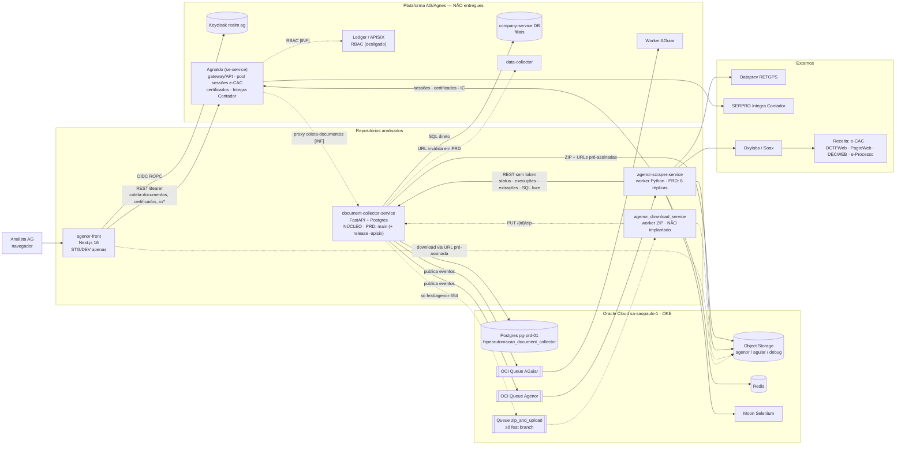

# Diagnóstico técnico do Agenor — estado atual e viabilidade de reconstrução

**Versão 2 — 07/10/2026.** Incorpora o `document-collector-service`.

**Escopo:** quatro repositórios clonados de `bitbucket.org/agnesprojects`:
- `agenor-front`
- `agenor-scraper-service`
- `agenor_download_service`
- `document-collector-service`

**Método:**
- Leitura do código e do histórico Git (`git log`/`diff`/`show`).
- Snapshots dos branches exportados com `git archive` para um diretório temporário, fora dos repositórios.
- Nenhum checkout, instalação, execução, alteração, commit ou push.
- Nenhum acesso de rede aos ambientes ou ao cluster. Tudo o que depende do que está implantado *agora* foi inferido a partir dos repositórios.

**Legenda:**

| Marca | Significado |
|---|---|
| **[FATO]** | Observado diretamente no código, na configuração ou no Git, com caminho e linha. |
| **[INF]** | Inferência baseada em evidências. |
| **[NC]** | Não confirmado. |

---

## 1. Resumo executivo

1. **O que é o Agenor.** Uma plataforma de coleta automatizada de documentos fiscais federais de empresas clientes da AG Capital, a partir do certificado digital de um procurador com procuração eletrônica no e-CAC.
   - Tipos coletados: DCTF, DCTFWeb, DARF, DIRF, GPS, PER/DCOMP, PER/DCOMP Consultor, Fontes Pagadoras e Créditos DCTFWeb. [FATO]

2. **Arquitetura.** É um único produto, montado como microsserviços que se comunicam por HTTP e por fila OCI.
   - **O núcleo é o `document-collector-service`.** [FATO]
     - É dono do banco PostgreSQL com o modelo de coletas.
     - Cria as coletas e publica na fila OCI consumida pelo scraper.
     - Recebe os callbacks do scraper.
     - Gera o ZIP consolidado e as URLs pré-assinadas.
   - O **front** não conversa com ele diretamente: chama o **Agnaldo**, usando os mesmos paths do document-collector. [INF forte: o Agnaldo/APISIX faz proxy]
   - O **Agnaldo** (não entregue) também mantém o pool de sessões e-CAC, os certificados e o acesso ao SERPRO.
   - O document-collector **também atende outro produto, o AGuiar**: intimações, despacho decisório e download de processos do e-Processo, com fila e bucket próprios. [FATO]

3. **Versão em uso.**

   | Componente | Branch / situação | Classificação |
   |---|---|---|
   | Scraper | `main`, com o mesmo conteúdo de `staging` | [INF forte] |
   | Document-collector | `main` em PRD; `staging` está 17 commits de código à frente, aguardando promoção | [INF forte] |
   | Front | **Não está em produção.** A `main` só tem "Initial commit"; o mais alto é `staging` | — |
   | Download service | Não implantado. O ZIP hoje é gerado dentro do document-collector; a integração com o download service existe só numa feature branch | [FATO] |
   | Instalação paralela `-apisix` (`migration/rbac-*`) | **Não está abandonada no document-collector.** Em PRD ela roda o sweeper do orquestrador em modo **ativo**, no mesmo banco e nas mesmas filas da instalação principal | [FATO nos values; NC no cluster] |

4. **Como o sistema funciona, em uma frase.** O usuário solicita uma coleta; o document-collector registra e publica na fila; o scraper consome, obtém uma sessão e-CAC no Agnaldo, coleta nos portais da Receita, grava os arquivos no bucket e devolve status e dados extraídos ao document-collector; o usuário acompanha e baixa os arquivos. O detalhamento está nas seções 4, 5 e 7.

5. **Onde está o conhecimento do domínio.**
   - **Scraper:** fluxos de cada portal (e-CAC, DCTFWeb, PagtoWeb, DECWEB, Dataprev, SERPRO) e regras fiscais (originais × retificadoras, competências, períodos).
   - **Document-collector:** modelo de dados das coletas, ciclo de status e extrações por tipo.
   - **Nada disso está documentado fora do código.**

6. **Lacunas de entendimento.**
   - Faltam o **Agnaldo** (sessões e-CAC, certificados, repasse de chamadas) e o acesso de leitura ao cluster de PRD.
   - Não se sabe **quem dispara coletas em produção**, já que o front não está em PRD (seção 15).

7. **Estado técnico e viabilidade.** As observações estão registradas nas seções 11 e 12. A avaliação preliminar da seção 16 aponta para uma evolução incremental, e não para uma reescrita, mas a decisão depende de fechar as lacunas acima.

---

## 2. Repositórios encontrados

| Repositório | Stack | Tamanho | Commits (todas as refs) | Branches remotas | Período |
|---|---|---|---|---|---|
| `agenor-front` | Next.js 16 (App Router), React 19, Auth.js v5 beta, TanStack Query, axios, shadcn/Tailwind 4, pnpm | médio | 295 | 12 | 08/2025 → 06/10/2026 |
| `agenor-scraper-service` | Python 3.12, Poetry, FastAPI/uvicorn (worker), Selenium/Moon, curl_cffi, MinIO S3, OCI SDK, Redis, pdfplumber/pymupdf/camelot/pandas | ~39,8 mil LOC em `app/`; 619 testes | 1.260 | 128 | 14/07/2025 → 06/10/2026 |
| `document-collector-service` | Python 3.12, FastAPI, SQLAlchemy 2 async + asyncpg, Alembic, PostgreSQL, OCI SDK, MinIO **e** boto3, pandas, gunicorn, uv **e** Poetry | ~37,7 mil LOC (services 10,1k, routers 4,9k); 685 testes | 1.103 | 125 | 14/07/2025 → 07/10/2026 |
| `agenor_download_service` | Python 3.12, Poetry, FastAPI, boto3, oci, zipstream-ng, httpx | 12 arquivos | 7 | 5 | 28/07 → 19/08/2026 |

- [FATO] Os READMEs são o template do Bitbucket ou não descrevem o sistema. A exceção é o README do front, que descreve a stack.
- [FATO] O checkout local de `agenor-front` e de `agenor_download_service` está na `main`, que só tem `.gitignore`/README. O código está em outros branches.
- [FATO] Scraper e document-collector nasceram no mesmo dia (14/07/2025, Gean Duarte), usavam Kafka e migraram juntos para a OCI Queue em 24/08/2025. São irmãos de origem.

---

## 3. Branches e identificação da versão atual

### 3.1 Evidência: pipelines (`bitbucket-pipelines.yml`)

Padrão comum [FATO]:
- Bitbucket Pipelines → imagem no Harbor (`registry.agnes.com.br`) → `helm upgrade --install` em clusters **OKE** (Oracle Kubernetes Engine).
- Front e scraper usam o chart compartilhado `agnesprojects/kubernetes-common-apps`.
- O document-collector tem o chart no próprio repositório (`helm/document-collector-service`).

| Repo | Branch | Ambiente | Namespace | Deploy |
|---|---|---|---|---|
| scraper / doc-collector | `main` | **PRD** | `hiperautomacao-prd` | **manual** |
| scraper / doc-collector | `staging` (doc-collector aceita também `homolog`) | STG | `hiperautomacao-stg` | automático |
| scraper / doc-collector | `dev` (doc-collector aceita também `develop`), `devops/pipeline` | DEV (cluster STG) | `hiperautomacao-dev` | automático |
| scraper / doc-collector | `migration/rbac-main` | PRD, release **`<serviço>-apisix`** | `hiperautomacao-prd` | manual |
| scraper / doc-collector | `migration/rbac-staging` | STG, release `-apisix` | `hiperautomacao-stg` | automático |
| scraper / doc-collector | `feature/pipeline` | DEV (cluster DEV, kgateway) | `hiperautomacao-dev` | via template `pipeline-templates` (06–07/10) |
| front | `main` | PRD (`agenor-prd`) | — | manual, **mas a `main` não tem código nem pipeline** |
| front | `staging` / `develop` | STG / DEV | `agenor-stg` / `agenor-dev` | automático |
| download | — | — | — | **sem CI nem Dockerfile** |

### 3.2 Posição dos branches em relação à `main`

| Repo | `staging` | `dev` | `migration/rbac-main` | `migration/rbac-staging` |
|---|---|---|---|---|
| scraper | +1 / −0 (conteúdo idêntico) | +41 / −137 | +20 / −137 | +17 / −170 |
| doc-collector | +29 / −2 (17 commits de código, 21 arquivos) | +16 / −121 | +36 / −138 | +27 / −138 |

**Fluxo real [FATO]:**
- feature → PR para `staging` → PR `staging` → `main` → deploy manual em PRD.
- Hotfixes entram direto na `main`.
- `dev` e `rbac-*` são alimentados por **cherry-pick**. Há dezenas de branches `cherrypick-*` em ambos os repositórios.

**Conclusões:**
- **PRD = `main`** no scraper (`3189af4`, 02/10) e no document-collector (PR #399, 02/10). [INF forte]
- [NC] Não dá para saber qual tag de imagem está rodando sem `helm history` ou `kubectl`, porque o deploy é manual.
- `dev` não representa o desenvolvimento atual em nenhum dos dois repositórios.
- **Pendente de PRD no document-collector (`staging`):**
  - `download-disponivel` (que o front já usa);
  - download por identificador;
  - endpoint de coletas travadas e `PATCH` para FAILED;
  - ZIP de GPS por filial;
  - filtro de status case-insensitive.

### 3.3 Instalação paralela APISIX (`migration/rbac-*`) — conclusão revisada

Na v1, a inferência era de que essa instalação estaria abandonada. Com o document-collector, ela foi revista:

- [FATO] **Document-collector:** os values de PRD de `migration/rbac-main` (`values-apisix.yaml:145-157`) definem o CronJob do orquestrador em **`mode: active`**, diário às 06:00. A instalação principal (`main`, `values.yaml:142-151`) roda o mesmo sweeper em **`mode: shadow`** a cada 2h.
  - As duas usam **o mesmo banco** (`hiperautomacao_document_collector_prd`), as mesmas filas e o mesmo Secret.
  - O commit `e7cb8b9` diz "desligado no normal (apisix é o dono)", mas um commit posterior religou o sweeper (em shadow) na instalação normal.
- [FATO] `migration/rbac-main` está 138 commits atrás da `main` e não tem, por exemplo, `path_s3`/`identificador_arquivo` nem o download de processos.
- [INF] A instalação `-apisix` é a rota para chamadas que passam pelo gateway APISIX com RBAC do Ledger. Deve continuar ativa em PRD, mas com **código desatualizado**.
- [NC] Se a release `-apisix` do **scraper** está ativa. Se estiver, ela consome a mesma fila da principal.

### 3.4 Front e download service

- **Front:**
  - [FATO] A `main` só tem "Initial commit". `develop` e `staging` estão praticamente iguais, com último commit em 06/10.
  - [FATO] O values de PRD foi copiado do `platform-front` (`platform-front:RELEASE-199`).
  - [FATO] O front usa `GET /{id}/download-disponivel`, que só existe no `staging` do document-collector. Isso é coerente com o front existir só em STG/DEV.
- **Download service:**
  - [FATO] Cadeia linear até `feat/service-zip` (19/08), sem merge.
  - [FATO] A contraparte no document-collector (publicar `zip_and_upload` e o callback `PUT /{id}/zip`) existe **apenas** na branch `feat/agenor-554` (commit `5065b86`).
  - [FATO] O ZIP em produção é gerado dentro do document-collector.
  - Conclusão: o download service é um **projeto de extração do ZIP, iniciado e não concluído**.

---

## 4. Descrição do produto

**O Agenor automatiza a obtenção de documentos e dados fiscais federais de empresas clientes.** Ele opera com o certificado de um procurador, guarda os arquivos e os dados extraídos e os disponibiliza para download e consulta.

**Fluxo ponta a ponta:**

1. **Usuário interno da AG** (Keycloak, realm `ag`) seleciona um CNPJ cliente e o certificado do procurador e solicita uma coleta com filtros. [FATO]
2. **Front → Agnaldo:** `POST coleta-documentos?force=true`. [FATO] O Agnaldo repassa ao document-collector. [INF forte]
3. **Document-collector** [FATO]:
   - cria `collected` e as `collection_execution`;
   - publica `{event_name, event_data}` na **OCI Queue do Agenor** (`OCI_AGENOR_QUEUE_ID`).
4. **Scraper** [FATO]:
   - consome a mensagem;
   - pede ao **Agnaldo** uma sessão e-CAC já autenticada do procurador;
   - troca o perfil para o cliente;
   - coleta no e-CAC, DCTFWeb, PagtoWeb, DECWEB, Dataprev ou SERPRO;
   - grava os arquivos no **OCI Object Storage**;
   - chama os callbacks do document-collector (status, execuções, extrações).
5. **Document-collector** [FATO]:
   - grava as extrações em tabelas próprias por tipo;
   - ao chegar em `FINISHED`/`PARTIALLY_FINISHED`, **gera o ZIP consolidado** e grava `collected.path_s3`;
   - fornece URLs pré-assinadas de 24h.
6. **Front:** acompanha por polling e baixa os arquivos.

**Usuários [INF]:** equipes internas da AG Capital / AG Tax. Indícios:
- SSO corporativo;
- ausência de RBAC e de filtro por usuário;
- `request_user_id` gravado só para auditoria.

**Outro produto no mesmo backend [FATO]:** o **AGuiar** usa o document-collector para:
- intimações (`download_intimacoes`);
- despacho decisório;
- download de processos do **e-Processo** (`DOWNLOAD_LEGAL_CASE_DOCUMENT`).

Ele tem fila (`OCI_AGUIAR_QUEUE_ID`) e bucket (`hiperautomacao-aguiar-<env>`) próprios. Os tickets `AGUIAR-*` confirmam. O worker que consome a fila do AGuiar não está entre os repositórios recebidos.

---

## 5. Funcionalidades e fluxos principais

### 5.1 Tipos de coleta e eventos [FATO]

| `CollectionType` | Evento publicado | Coletor (scraper) | Fonte | Tela no front |
|---|---|---|---|---|
| DCTF_WEB | `download_dctf_web_dossie` | `DctfWebCollectorRequest` | DCTFWeb (HTTP) | sim |
| DCTF | `download_dctf_dossie` | `DctfCollector` | ATSPO + DECWEB | sim |
| PERDCOMP | `download_perdcomp_web_dossie` | `PerdcompWebCollector` | e-CAC | sim |
| PERDCOMP_CONSULTANT | (idem família) | `PerdcompConsultantCollector` | `/consprocperdcomp` | sim (06/10) |
| GPS | `download_gps_web` | `GpsWebCollector` | Dataprev RETGPS | sim (+ filiais) |
| DIRF | `download_dirf` | `DirfWebCollector` | DECWEB | sim |
| DARF | `download_darf` | `DarfWebCollector` | PagtoWeb / SERPRO Integra Contador | sim |
| FONTES_PAGADORAS | `download_fontes_pagadoras` | `FontesPagadorasCollector` | e-CAC | **não** |
| CREDITOS_DCTF_WEB | `download_creditos_dctf_web` | `CreditosDCTFWebCollector` (Selenium/Moon) | DCTFWeb | **não** |
| DESPACHO_DECISORIO, INTIMACAO, DOWNLOAD_LEGAL_CASE_DOCUMENT | `download_despacho_decisorio`, `download_intimacoes`, `download_legal_case_document` → **fila AGuiar** | não está no scraper do Agenor | e-CAC / e-Processo | não (produto AGuiar) |

Também existe `POST /coleta-documentos/coleta-completa`, que dispara vários tipos de uma vez. [FATO]

**Regras de negócio no scraper [FATO]:**
- Período DCTFWeb quebrado em semestres.
- Ativa × Retificada (`dctf_web_utils.py:127-217`) e `somente_originais`.
- Mês 13 = anual.
- Fontes Pagadoras: últimos 5 anos + ano corrente.
- Particionamento DARF mensal/anual (com bug, ver §12).
- Circuit-breaker do SERPRO.
- Chaves determinísticas no bucket (`{cnpj_cert}/{cliente}/{tipo}/{mes}/{ano}/arquivo`), que permitem retomar coletas.
- Classificação Original/Retificadora/Cancelada (`tipo_versao_documento`, gravado no document-collector).

### 5.2 Ciclo de vida e status [FATO]

```
Front/Agnaldo ──POST──▶ document-collector: collected=PENDING (+ execuções) ──▶ OCI Queue Agenor
Scraper consome ─▶ lock(collected_id) ─▶ Agnaldo: sessão e-CAC p/ procurador
   ├─ sem sessão → PUT status WAITING_SESSION e APAGA a mensagem   ◀── ninguém reenfileira (ver abaixo)
   ├─ procuração inválida → FAILED
   └─ PROCESSING → baixa → bucket → PUT/POST execucao(ões) → POST *-extract
        → FINISHED | FINISHED_EMPTY | PARTIALLY_FINISHED | FAILED
document-collector: ao finalizar → gera ZIP consolidado (in-process) → collected.path_s3
```

- **Status da coleta (`CollectedStatus`):** PENDING, PROCESSING, WAITING_SESSION, FINISHED, PARTIALLY_FINISHED, FINISHED_EMPTY, FAILED, FILE_NOT_FOUND.
- As execuções usam os mesmos valores, exceto PARTIALLY_FINISHED.
- Cada mudança de status é auditada em `collected_status_events` e `collection_execution_events`.

### 5.3 Recuperação de coletas travadas [FATO]

| Mecanismo | Situação |
|---|---|
| Reprocessamento de `WAITING_SESSION` (`collection_reprocess_routines.py`) | **Código morto.** O scheduler que o chamava foi apagado em 22/04/2026 (`a058196`). Tinha bug: republicava tudo como DCTFWeb. |
| Orquestrador AGENOR-545 (CronJob `sweep`) | Considera só coletas **PENDING** travadas, dos tipos DCTF_WEB, DARF, DIRF e GPS, no máximo 10 por rodada. **Exclui WAITING_SESSION de propósito** (`orchestrator_repository.py:26,125`). Shadow só registra em `collection_attempt`; active republica via `reprocess_collection`. `dispatch_due_attempts` é stub. |
| Watchdog AGENOR-574 | Só na branch `feat/agenor-574`. Marca como FAILED, não reenfileira. |
| Manual | `POST /{id}/reprocessar`; em staging, `GET /coleta-documentos/travadas` + `PATCH .../status/failed`. O front sempre envia `force=true`. |

**Consequência [INF forte]:** coletas que caem em `WAITING_SESSION` ficam paradas até alguém refazer a solicitação manualmente.

### 5.4 Front (staging) [FATO]

- Telas: login → dashboard (estatísticas por tipo) → **Projetos (só em localStorage)** → detalhe (QSA, CNDT) → escolha do certificado → tela do tipo → iniciar → acompanhar (stepper) → baixar.
- O front não tem telas para Fontes Pagadoras e Créditos.

---

## 6. Arquitetura

### 6.1 Componentes

| Componente | Repo entregue? | Papel | Evidência |
|---|---|---|---|
| agenor-front | ✅ | UI | — |
| **document-collector-service** | ✅ | **Núcleo:** API de coletas, banco, publicação na fila, callbacks, extrações, ZIP, URLs pré-assinadas, orquestrador. Atende Agenor **e AGuiar** | §4–§8 |
| agenor-scraper-service | ✅ | Worker de coleta | — |
| agenor_download_service | ✅ (protótipo) | Worker de ZIP, não integrado | — |
| **Agnaldo** (`se-service:9096`; `agnaldo.{env}.agcapital.com.br/api/v1`) | ❌ | API de entrada do front (proxy [INF] para o doc-collector), pool de sessões e-CAC, certificados, Integra Contador/SERPRO, `POST /auth/token` para robôs | front `fetcher.ts`; scraper `connectors/agnaldo.py` |
| Ledger (`agnaldo-ledger`) / APISIX | ❌ | Gateway + RBAC por rota (`/routes/{sha256(path)}/can_access_route`) + lifecycle/billing | doc-collector `main.py` (middleware) |
| company-service (banco) | ❌ | Tabela `establishment` (filiais/NRINSC), lida **diretamente** pelo doc-collector em outro Postgres | doc-collector `establishment_repository.py` |
| data-collector | ❌ | Ingestão de dados; desligado no scraper e com URL inválida em PRD no doc-collector | — |
| Worker do AGuiar | ❌ | Consome a fila do AGuiar | doc-collector |
| session-manager | ❌ | Legado, substituído pelo Agnaldo em 08/2026 | — |
| Keycloak (`sso[.stg].agnes.com.br/realms/ag`) | externo | SSO do front | — |
| OCI Queue / Object Storage / Postgres (`pg-prd-01`) — `sa-saopaulo-1` | infra | Filas, arquivos, banco | values |
| Redis, Moon, Oxylabs/Soax, Sentry/OTel/Prometheus | infra/SaaS | Locks, Selenium grid, proxies, observabilidade | scraper |

### 6.2 Estilo arquitetural [INF]

- Microsserviços orientados a fila, dentro de uma plataforma maior de "hiperautomação" da AG/Agnes, com namespaces `hiperautomacao-*` e vários robôs e produtos.
- O Agnaldo atua como gateway/backend central e o APISIX/Ledger como camada de autorização em adoção.
- O Agenor **não é autocontido**: compartilha backend (document-collector), gateway (Agnaldo) e infraestrutura com o AGuiar e outros produtos.

---

## 7. Comunicação entre os projetos

| Origem → Destino | Meio | O que trafega | Classificação |
|---|---|---|---|
| Front → Agnaldo | REST, Bearer Keycloak | `coleta-documentos` (create/list/stats/item/download-url/download-disponivel/branches), `certificados`, `ic/consultar-cnpj`, `infos/cndt` | FATO |
| Agnaldo → document-collector | REST (proxy, paths idênticos) | as chamadas `coleta-documentos` do front | INF forte |
| document-collector → scraper | **OCI Queue Agenor** | `{event_name, event_data{collected_id, power_of_attorney, company, data_filters, force, external_id, user_info, lifecycle_id}}` | FATO |
| scraper → document-collector | REST, headers fixos `X-User-ID: agenor` + `X-Bypass-Ledger-RBAC`, **sem token** | status, execuções (unitário/batch), extrações, IC executions, verificar-downloads, particionamento DARF, SQL (`query_consult`) | FATO |
| scraper → Agnaldo | REST, Bearer de robô (`POST /auth/token`) | sessões e-CAC, troca de perfil, certificados, Integra Contador | FATO |
| scraper/document-collector → Object Storage | S3-compat | arquivos, ZIP, URLs pré-assinadas | FATO |
| document-collector → company-service DB | **conexão direta ao Postgres de outro serviço** | filiais (`establishment`) | FATO |
| document-collector → fila AGuiar | OCI Queue | intimações, despacho, e-Processo | FATO |
| document-collector → download service | fila `zip_and_upload` + callback `PUT /{id}/zip` | **só em `feat/agenor-554`** | FATO |

**Respostas diretas:**

- **Compartilham banco?**
  - Front, scraper e download service não têm banco; o document-collector é o dono. [FATO]
  - O document-collector lê **diretamente** o banco do company-service. [FATO]
  - As instalações normal e `-apisix` do document-collector compartilham o mesmo banco. [FATO]
- **Compartilham autenticação? Não.** [FATO]
  - Front: Keycloak, com grant ROPC, client `agnaldo`.
  - Scraper → Agnaldo: usuário de robô.
  - Scraper/download → document-collector: só headers, que qualquer chamador pode forjar.
  - O RBAC do Ledger está **desligado em todos os values** (`ENABLE_RBAC: "False"`), e o middleware só atuaria com `ENVIRONMENT == "staging"`.
- **Infraestrutura:** mesmos Harbor, OKE, Bitbucket, buckets (`hiperautomacao-agenor-<env>`) e filas. Namespaces `hiperautomacao-*` para os backends e `agenor-*` para o front.
- **Filas:** o document-collector publica e o scraper consome. A fila do download service ainda não foi implantada.
- **Funcionam isoladamente? Nenhum.**
  - O scraper depende de document-collector + Agnaldo + fila + bucket.
  - O document-collector sem o scraper só registra coletas, que ficam PENDING.
  - O front depende do Agnaldo.

### 7.1 Contratos quebrados entre os serviços [FATO]

| Chamador | Endpoint chamado | Situação no document-collector |
|---|---|---|
| scraper (`document_collector_connector.py:502`) | `POST /{id}/perdcomp-all-data` | **Não existe em nenhuma branch nem no histórico.** Resulta em 404. |
| front (`coletas/api.ts:255`) | `GET /{id}/download-disponivel` | Só em `staging`. Em PRD resultaria em 404. |
| front | `GET /{id}/download-url?filial_completa=true` | Em `staging` passa a devolver **uma única URL** de ZIP, contra uma lista na `main`. Mudança de contrato. |
| download service | `PUT /{id}/zip` | Só em `feat/agenor-554`. |

---

## 8. Banco e principais entidades

**Banco [FATO]**
- PostgreSQL (`postgresql+asyncpg`), banco `hiperautomacao_document_collector_<env>` no servidor `pg-prd-01` em PRD.
- Pool de 20 conexões + 30 de overflow.
- Migrações Alembic aplicadas **no start do container** (`entrypoint.sh: alembic upgrade head`).

| Tabela | Conteúdo |
|---|---|
| `collected` | Coleta. `id` UUID, `client_document`, `power_of_attorney_document`, `request_user_id/name`, `request_payload`/`response_payload` (JSON), `status`, `collection_type` (String(50)), `path_s3` (ZIP), `finished_at` |
| `collection_execution` | Item por competência/relatório. `report_type_id`, `competence`, `assessment_*`, `file_id`, `uri_files`, `tipo_versao_documento`, `identificador_arquivo`, `status`, `error_message`, `invalid_at` |
| `report_type` | Catálogo de tipos de relatório |
| `collected_status_events`, `collection_execution_events` | Auditoria de transições |
| `ic_service_execution` | Auditoria das chamadas ao SERPRO (payloads JSONB) |
| `collection_attempt` | Orquestrador: estratégia, tentativa, status, `mode` shadow/active, `next_attempt_at`, `decision_log` |
| Extrações | `perdcomp_extract`, `document_data_perdcomp`, `credito_dctf_web`, `dctf_extract_pdf`, `dctf_extract_dec`, `darf_extract`, `gps_extract`, `dirf_extract`, `fontes_pagadoras_extract`, `dctf_web_extract`, `intimacao_extract`, `intimacao_extract_event` |
| `establishment` (**outro banco**, company-service) | Filiais: cnpj, prefixo, ordem, dígito, `identifier`, nome |

**Entidades fora do document-collector:**
- **Sessão e-CAC** e **Certificado** (`password`, `file`, validade) → Agnaldo. [NC sobre o armazenamento]
- **Projeto** → **localStorage do navegador**. Não existe no backend.

**Saúde das migrações [FATO]**
- 57 revisões, 12 delas de merge.
- IDs artificiais (`a1b2c3d4e5f6`) e branch `fix/alembic-duplicate-revision`.
- **O mesmo ID `20260701_merge_heads` tem `down_revision` diferente** em `main` e em `migration/rbac-main`.
- Heads diferentes por branch: `main` `20260824_ident_arquivo`, `rbac-main` `20260723_attempt_mode`.

---

## 9. Integrações

| Integração | Usada por | Tipo | Complexidade/risco |
|---|---|---|---|
| e-CAC / CAV / DCTFWeb / PagtoWeb / DECWEB | scraper | Scraping HTTP + Selenium com sessão de procurador | **Muito alta**: sem API oficial, sujeito a 401/503/bloqueios |
| e-Processo (Receita) | document-collector (AGuiar) | HTTP com User-Agent falsificado | Alta |
| Dataprev RETGPS | scraper | via e-CAC | Alta |
| SERPRO Integra Contador | scraper via Agnaldo | API oficial paga | Média |
| Agnaldo | front, scraper | REST | **Crítica**, não entregue |
| Ledger / APISIX | document-collector | RBAC por rota (desligado) | Média, não entregue |
| company-service DB | document-collector | Postgres direto | Alta (acoplamento por banco) |
| Keycloak | front | OIDC (ROPC) | Média |
| OCI Queue / Object Storage / Postgres | todos | SDK OCI / S3 | Média (lock-in OCI) |
| Oxylabs / Soax | scraper | Proxies | Média (custo) |
| Moon | scraper | Selenium grid | Média |
| data-collector | scraper, document-collector | REST | Desativado / URL inválida em PRD (`host.docker.internal`) |
| Sentry / OTel / Prometheus | scraper, document-collector | Observabilidade | Baixa |

---

## 10. Infraestrutura e ambientes

### 10.1 Mapa branch → ambiente → aplicação → infraestrutura

| Branch | Ambiente | Aplicação / release | Infraestrutura (values) | Estado |
|---|---|---|---|---|
| scraper `main` | PRD | `agenor-scraper-service` | ns `hiperautomacao-prd`, **6 réplicas**, 4 GiB, Redis lock, proxy on, `DEBUG_MODE: true` | em uso [INF forte] |
| doc-collector `main` | PRD | `document-collector-service` | 1 réplica, 2 CPU / 2 GiB, gunicorn 1 worker (timeout 6000 s), sweeper **shadow** a cada 2h, `pg-prd-01` | em uso [INF forte] |
| doc-collector `migration/rbac-main` | PRD | `document-collector-service-apisix` | mesmo banco/filas, sweeper **active** diário às 06:00, host `-apisix.prd` | provável em uso, com código de 30/07 [INF] |
| scraper `migration/rbac-main` | PRD | `agenor-scraper-service-apisix` | 2 réplicas, mesma fila? | [NC] |
| scraper / doc-collector `staging` | STG | releases principais | 1 réplica; sem sweeper | em uso |
| `rbac-staging` (ambos) | STG | releases `-apisix` | — | [NC] |
| scraper / doc-collector `dev` | DEV | releases principais | cluster STG | desatualizado |
| front `staging` / `develop` | STG / DEV | `agenor-front` | `agenor.{stg,dev}.agcapital.com.br` | em uso |
| front `main` | PRD | — | — | **sem código** |
| download `feat/service-zip` | — | — | — | não implantado |

**Hosts (ingress nginx + cert-manager; backends com whitelist de IPs privados):**
- `agenor-scraper-service.{env}.agcapital.com.br`
- `document-collector-service[-apisix].{env}.agcapital.com.br`
- `agenor.{env}.agcapital.com.br`

### 10.2 Detalhes [FATO]

- **Imagens:**
  - front: `node:22-alpine` standalone, com variáveis `NEXT_PUBLIC_*` no build;
  - scraper: base interna com Chrome, `opentelemetry-instrument uvicorn`;
  - doc-collector: `python:3.12-slim` + `uv:latest` (sem versão fixa), `entrypoint.sh` com Alembic + gunicorn.
- **Configuração:**
  - ConfigMaps (`config:` nos values) + Secrets `<serviço>-secrets`;
  - **exceção:** a senha do banco de filiais (usuário `postgres`) está no ConfigMap em todos os ambientes (`oke-prd-01/values.yaml:131`).
- **CI:**
  - scraper e doc-collector com SonarCloud + Dependency-Track, **sem executar testes**;
  - front com steps de qualidade `echo "TODO"`;
  - `k8s-helm:latest`;
  - erro de digitação `K8s_CLUSTER` (funciona por acaso).
- Não há Terraform/IaC de cluster, fila, bucket ou banco nos repositórios.

---

## 11. Estado atual do código

### 11.1 document-collector-service

**Positivo:**
- camadas `routers → services → repositories → models` claras;
- SQLAlchemy 2 async;
- auditoria de status em tabelas de eventos;
- 685 testes;
- orquestrador bem desenhado (shadow/active, `decision_log`).

**Negativo:**
- `collection_service.py` (1.113 LOC) e `collection_download_service.py` (830).
- Zipagem síncrona dentro do request de callback do scraper, movida para `asyncio.to_thread` em 01–02/10.
- Duplicações: dois engines de banco, dois conectores de storage (MinIO e boto3), `poetry.lock` + `uv.lock`, `ENABLE_RBAC` declarado duas vezes.
- Cada serviço instancia um `OCIQueueConnector` e grava a chave privada em arquivo temporário a cada instância.
- Código morto: rotina de reprocessamento, `dispatch_due_attempts` (stub), middleware `log_request` sem efeito, `/api/v1/health/` que sempre devolve `{}`, `_cache` sem uso no middleware RBAC, `print` de debug.
- Endpoints de teste/debug ativos em PRD: `POST /test-collected` (cria `collected` arbitrário) e `/sentry-debug` (público).
- Migrações bagunçadas (§8).
- `config.py` cita `docs/specs/2026-07-20-orquestrador-coletas-design.md`, que **não existe**.
- README vazio.
- **Mistura de produtos:** Agenor e AGuiar no mesmo serviço, banco e código.

### 11.2 agenor-scraper-service

**Positivo:**
- camadas `connectors/services/schemas/utils`;
- Pydantic;
- locks e idempotência;
- chaves determinísticas;
- observabilidade;
- 619 testes (parsers, máquina de estados de créditos).

**Negativo:**
- Monólitos: `dctf_web_collector_request.py` 2.980 LOC, `darf_web_collector.py` 2.406, `dctf_web_collector.py` 1.861 (morto).
- Sem testes nos coletores principais.
- Lógica de sessão, perfil e status repetida em todos os coletores.
- Erros classificados por substring da mensagem.
- `AgnaldoConnector` importado com o alias `SessionManagerConnector`.
- Código morto: stub `fill_dctf_web`, data-collector comentado, instrumentação "DISCOVERY", restos de Kafka.
- Documentação contradiz o código: `ledger_integration.md` cita `domains/billing`, mas o scraper usa `domains/ledger` (o doc-collector, sim, usa `billing`); `code_style.md` exige repositories.

### 11.3 agenor-front

**Positivo:** stack moderna, organização por features com regra de dependência no lint, TypeScript strict, refresh de token.

**Negativo:**
- Projetos em localStorage.
- 7 telas e 5 diálogos quase idênticos.
- Restos do `platform-front`, incluindo a AGuIA em stub.
- Bugs concretos:
  - redirect quebrado;
  - DCTFWeb envia `Date.toString()`;
  - parser de certificado espera `nome:cnpj`.
- Sem testes de coletas.

### 11.4 agenor_download_service

- Pequeno, sem testes nem infraestrutura.
- Mensagens inválidas ficam em loop na fila; sem idempotência.
- Depende de um branch não mergeado do document-collector.

### 11.5 Processo

- Mais de 250 branches somando scraper e doc-collector, dezenas de cherry-picks, nenhuma tag.
- Linhas `main`, `dev` e `rbac-*` divergentes, com correções portadas à mão.
- `feature/pipeline` criado a partir do `dev` desatualizado nos dois repositórios.
- Rotatividade:
  - o autor original (Gean Duarte) saiu em 01/2026;
  - Patrick Covre é hoje o principal mantenedor dos backends;
  - Yargo Siqueira (orquestrador, perf) atuou até 09/2026.

---

## 12. Débitos técnicos e riscos

| # | Risco | Severidade | Evidência |
|---|---|---|---|
| 1 | **SQL livre executado no banco de PRD**: blacklist por substring, transação não somente leitura, sem timeout, erro do Postgres devolvido ao cliente, "autenticação" = qualquer `X-User-ID`/`X-User-Name`. Permite ler todos os dados fiscais e fazer DoS (`pg_sleep`). | **Crítica** | doc-collector `app/routers/query_router.py:13-66`; chamado pelo scraper `utils/perdcomp_scrapper.py:107` |
| 2 | **Sem autenticação/autorização real entre serviços e sem isolamento por usuário**: RBAC desligado em todos os values; headers forjáveis; nenhuma consulta filtra por usuário | **Crítica** | doc-collector `dependencies.py`, `main.py`, `values*.yaml` (`ENABLE_RBAC: "False"`) |
| 3 | **Credenciais no histórico Git**: chave privada OCI (scraper e doc-collector, 08/2025), senha Agnaldo/IC (scraper, 03–07/2026), possível senha Oxylabs em teste. Árvores atuais limpas. **Rotacionar.** | **Crítica** | scraper `0e47536`, `0a687f1`, `00412d5`, `01b9f54`, `6af7ea5`, `ab1cabb`…`c388208`; doc-collector `cf50108`, `7ba88d8`, `fc4e201` |
| 4 | **Superusuário `postgres` do banco do company-service** com senha trivial no ConfigMap, e URL completa gravada em log INFO | **Alta** | doc-collector `kubernetes/*/values*.yaml` (PRD `:131`), `app/database.py` |
| 5 | **Coletas em `WAITING_SESSION` nunca são retomadas automaticamente** (scraper apaga a mensagem; reprocessador morto; sweeper as exclui) | **Alta** (funcional) | §5.3 |
| 6 | **Duas instalações em PRD no mesmo banco, com heads Alembic divergentes e migração no start**: risco de CrashLoop da `-apisix` no próximo restart, ou de migração inconsistente; ID de revisão duplicado com `down_revision` diferente | **Alta** | §8; `entrypoint.sh` |
| 7 | Orquestrador active na `-apisix` com código de 30/07 (138 commits atrás) operando sobre dados gravados pela versão atual | Alta | §3.3 |
| 8 | `DEBUG_MODE` e vídeo do Moon em PRD com dados fiscais | Alta (LGPD/sigilo fiscal) | scraper `oke-prd-01/values.yaml:149` |
| 9 | Endpoints de teste/debug em PRD (`/test-collected`, `/sentry-debug`) | Média | doc-collector |
| 10 | Contratos quebrados (`perdcomp-all-data`, `download-disponivel`, `filial_completa`, `/zip`) | Média | §7.1 |
| 11 | Health checks falsos: o scraper não detecta consumidor morto; o `/health` do doc-collector sempre devolve 200 | Alta | scraper `lifecycle.py:62`; doc-collector `health_router` |
| 12 | Particionamento DARF adaptativo não funciona (`usar_mensal` ignorado) | Média | scraper `darf_web_collector.py:1361-1375` |
| 13 | ZIP gerado dentro do request de callback (1 worker gunicorn) | Média (performance) | doc-collector `collection_execution_service.py:253-304` |
| 14 | Acoplamento por banco com o company-service e mistura Agenor/AGuiar no mesmo serviço | Média (evolução) | §6 |
| 15 | Front usa ROPC com o client confidencial do backend; `Certificado` (com `password`/`file`) gravado no localStorage | Média / Alta [NC] | front `next-auth/index.ts`, `select-certificado-dialog.tsx:45` |
| 16 | Branches divergentes, cherry-pick, CI sem testes, sem tags | Média | §3, §11.5 |
| 17 | Dependência estrutural de scraping de portais do governo | Alta (inerente) | scraper |
| 18 | Conhecimento concentrado em poucas pessoas; documentação inexistente ou errada | Alta | histórico |

---

## 13. O que pode ser reaproveitado

**document-collector**
- **Modelo de dados:** `collected`, `collection_execution`, eventos de auditoria, `ic_service_execution`, tabelas de extração por tipo. Coerente e com histórico de produção.
- Estrutura em camadas (routers/services/repositories), schemas Pydantic dos payloads e testes.
- Orquestrador: `collection_attempt`, `strategy_chains`, modos shadow/active.
- Geração de URLs pré-assinadas e consolidação de filiais (GPS/NRINSC).

**scraper**
- Fluxos do e-CAC (sessão → token → perfil), contornos de 401/503, proxies com fallback.
- Regras fiscais, parsers e extratores (os mais testados).
- Locks, renovação de visibilidade, chaves determinísticas, observabilidade.

**front**
- Autenticação e refresh, `fetcher`, schemas zod, `ProcessTracker`, agregação de filiais, design system.

**download service**
- `zip_stream_service` (ZIP em streaming), útil para tirar a zipagem do request do document-collector.

**infraestrutura**
- Harbor + Helm + OKE + OCI já operantes.
- Os dados existentes (Postgres + bucket com chaves determinísticas) podem ser mantidos.

---

## 14. O que provavelmente precisa ser reconstruído

1. **Camada de segurança entre serviços:**
   - autenticação real (client credentials/JWT) no lugar de headers;
   - RBAC ativo;
   - **remoção do `query_consult`**, substituído por endpoints específicos;
   - remoção dos endpoints de teste/debug;
   - credenciais em Secrets e rotacionadas.
2. **Ciclo de vida e retentativa das coletas:**
   - tratamento de `WAITING_SESSION` (reenfileirar com backoff quando houver sessão);
   - DLQ e limite de tentativas;
   - um único dono do orquestrador;
   - health checks reais.
3. **Pipeline comum de coleta no scraper:** extrair sessão/perfil/status/idempotência/upload/registro, quebrar os monólitos DCTFWeb e DARF e usar erros tipados.
4. **Persistência de Projetos/Clientes e certificados no backend** (hoje no localStorage), e o fluxo de autenticação do front (Authorization Code + PKCE com client próprio).
5. **Geração de ZIP assíncrona:** concluir a integração com o download service (`feat/agenor-554` + `feat/service-zip`) ou usar um job interno.
6. **Separação de responsabilidades:**
   - decidir se o document-collector continua compartilhado entre Agenor e AGuiar ou se é dividido;
   - eliminar o acesso direto ao banco do company-service.
7. **Processo e CI/CD:**
   - uma única linha `main` ← `staging` ← features;
   - aposentar ou realinhar `dev` e `rbac-*`;
   - consolidar o histórico do Alembic;
   - migrações como Job, não no start do pod;
   - testes no pipeline;
   - tags de versão.

**Não reescrever sem necessidade:** regras fiscais, extratores e modelo de dados.

---

## 15. Pontos que ainda não foi possível determinar

1. **Agnaldo** (não entregue):
   - como mantém o pool de sessões e-CAC (login com certificado A1? renovação?);
   - onde e como guarda certificados e senhas;
   - se de fato faz proxy de `coleta-documentos` para o document-collector;
   - se `GET certificados` devolve `password`/`file` ao navegador.
2. **Quem dispara coletas em PRD.** O front não está em PRD, mas o scraper roda com 6 réplicas. Possibilidades: outro front (platform-front?), integrações via Agnaldo (`external_id`, `user_info`, `coleta-completa`) ou uso direto da API. [NC]
3. **Estado real do cluster:**
   - tags implantadas;
   - se as releases `-apisix` (doc-collector e scraper) estão ativas e saudáveis;
   - qual sweeper realmente roda;
   - se há DLQ/maxDeliveries nas filas OCI.
4. Configuração do **APISIX/Ledger** (rotas, RBAC) e do **company-service**.
5. Worker do **AGuiar** e o impacto de mudanças no document-collector sobre esse produto.
6. **Volumes:** coletas por dia, tamanho do banco e do bucket, taxa de `WAITING_SESSION` e FAILED.
7. Se as credenciais expostas no histórico já foram rotacionadas.
8. Custos e contratos: SERPRO, Oxylabs, Soax, Moon.

---

## 16. Avaliação da viabilidade de reconstrução

### 16.1 Complexidade

**Domínio: alta.** Regras fiscais (versões, competências, retificações), scraping de portais governamentais instáveis, gestão de sessões e procurações, sigilo fiscal e LGPD. O conhecimento está **apenas no código**: no scraper e no modelo do document-collector, além de dezenas de tickets AGENOR-xxx.

**Integrações: altas.**
- Receita (vários portais), Dataprev, SERPRO.
- Agnaldo (sessões e certificados), proxies, Moon.
- Banco do company-service, Ledger/APISIX.

### 16.2 Avaliação por componente

| Componente | Recomendação | Risco de perder comportamento |
|---|---|---|
| **document-collector** | **Manter e refatorar.** É o ativo de dados. Prioridades: segurança, ciclo de vida das coletas, migrações, separação Agenor/AGuiar | Médio (contratos com scraper, front, AGuiar, Agnaldo) |
| **scraper** | **Refatorar incrementalmente**, tipo a tipo (*strangler*), usando os testes de parser como rede de segurança | **Alto se reescrito**: regras e contornos não documentados |
| **front** | **Refatorar ou reconstruir** (custo moderado). Não está em PRD; precisa de backend para Projetos | Baixo / médio |
| **download service** | **Concluir** junto com `feat/agenor-554`, ou absorver como job | Baixo |
| **Agnaldo** | **Avaliar antes de decidir.** Contém a parte mais sensível: sessões, certificados, credenciais | Desconhecido |

### 16.3 Migração de dados

- Com a manutenção do document-collector e do OCI, **não há migração de dados necessária**:
  - o Postgres (`hiperautomacao_document_collector_<env>`) e o bucket (chaves determinísticas) continuam;
  - as mudanças viram migrações Alembic incrementais.
- Uma reconstrução com outro modelo ou outra nuvem exigiria migrar cerca de 20 tabelas, todos os objetos do bucket e o banco do company-service. [INF] É um custo alto e sem ganho evidente.

### 16.4 Conclusão

- **Avaliação preliminar:** a reconstrução parece viável e tende a ser evolutiva, preservando o modelo de dados do document-collector e o conhecimento embutido no scraper.
- **Esta etapa é de entendimento.** A decisão sobre como reconstruir depende de:
  - analisar o repositório do Agnaldo;
  - confirmar no cluster o que está de fato implantado (versões, releases `-apisix`, sweeper);
  - identificar quem dispara coletas em PRD e qual é o volume de uso;
  - entender o papel do AGuiar no document-collector.
- Os riscos registrados na seção 12 são insumo para essa decisão, e não um plano de ação desta etapa.

---

## 17. Diagrama da arquitetura atual



**Leitura:**
- Linhas contínuas: integrações observadas no código ativo da `main` [FATO].
- Linhas pontilhadas: inferidas, em branch não mergeado ou desativadas.
